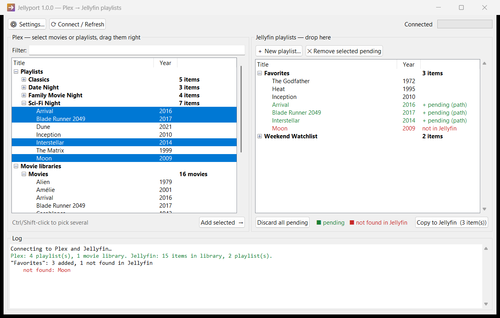

<p align="center">
  
</p>

<h1 align="center">Jellyport</h1>

<p align="center">
  <b>Move your Plex playlists to Jellyfin — with drag and drop.</b><br>
  Free, open source and runs on Windows. No command line needed.
</p>

<p align="center">
  <a href="https://github.com/BintChar247/jellyport/releases"></a>
  <a href="https://github.com/BintChar247/jellyport/releases/latest"></a>
  <a href="https://github.com/BintChar247/jellyport/stargazers"></a>
</p>

<p align="center">
  <a href="https://github.com/BintChar247/jellyport/releases/latest"><b>⬇ Download for Windows</b></a> ·
  <a href="https://BintChar247.github.io/jellyport/">Website</a> ·
  <a href="https://github.com/BintChar247/jellyport/issues">Report a problem</a>
</p>



---

Moving from Plex to Jellyfin? Your movies come across easily, but your playlists don't.
Jellyport shows your Plex playlists and libraries next to your Jellyfin playlists,
so you can pick exactly what you want and drag it over.

## Features

- **See both sides at once.** Plex playlists and movie libraries are on the left, and
  Jellyfin playlists are on the right.
- **Drag and drop.** Drag single movies, a selection, or whole playlists.
- **Preview before anything changes.** New items show in green and missing items show
  in red. Nothing is written to Jellyfin until you click **Copy to Jellyfin**.
- **Smart matching.** Movies are matched by file path, IMDb, TMDb or TVDb ID, or title
  and year. This works even when Jellyfin runs in Docker and sees your NAS folders
  under different paths.
- **No duplicates.** Movies that are already in a playlist are skipped, so you can run
  it again safely.
- **Your data stays on your network.** Jellyport talks only to your own servers. It
  has no accounts and no tracking.
- **A command-line version is included** for copying everything in one go or running
  it on a schedule.

## Install

1. Download **`Jellyport-Setup-x.y.z.exe`** from the
   [latest release](https://github.com/BintChar247/jellyport/releases/latest).
2. Run it. The installer doesn't need admin rights.

> **Windows SmartScreen** may warn about an "unrecognized app", because the installer
> isn't code-signed. Click **More info → Run anyway**. You can always build it
> yourself from source (see below).

Prefer Python? Jellyport uses only the standard library, so this works on Windows,
macOS and Linux:

```bash
python jellyport.py
```

## Setup

On first launch, the **Settings** window opens.

| Setting | Where to find it |
|---|---|
| **Plex URL** | `http://<server-ip>:32400` |
| **Plex token** | In Plex Web, open any movie, then choose **⋯ → Get Info → View XML**. Copy the value after `X-Plex-Token=` in the address bar. |
| **Jellyfin URL** | The address you use to open Jellyfin, e.g. `http://<server-ip>:8096` |
| **Jellyfin API key** | **Dashboard → API Keys → +** |
| **Jellyfin user** | The user who should own the playlists |
| **Path mappings** | Optional. See below. |

### Path mappings (Docker / NAS users)

If Plex and Jellyfin see the same files under different paths, add a mapping so the
file-path match works. This is common when one of them runs in Docker. For example:

```
/volume1/video/Movies  =>  /media/movies
```

To find the paths:
- **Plex:** **Settings → Libraries → Edit → Add folders**
- **Jellyfin:** **Dashboard → Libraries**

Without a mapping, Jellyport still matches movies by IMDb or TMDb ID, or by title
and year.

## How to use

1. Click **Connect**. Your playlists load on both sides.
2. Expand a Plex playlist or library, then select movies. Use Ctrl-click or Shift-click
   to pick several.
3. **Drag** them onto a Jellyfin playlist:
   - Drop onto an existing playlist to add the movies to it.
   - Drop a whole Plex playlist onto empty space to create a Jellyfin playlist with
     the same name.
   - Use **＋ New playlist…** to start an empty playlist.
4. Check the green (pending) and red (not found) rows, then click **Copy to Jellyfin**.

## Command line

```bash
python jellyport_cli.py --list
```

```bash
python jellyport_cli.py --dry-run
```

```bash
python jellyport_cli.py -p "Date Night"
```

```bash
python jellyport_cli.py
```

| Option | What it does |
|---|---|
| `--list` | Lists the Plex playlists and exits |
| `--dry-run` | Shows the matches and planned changes without changing anything |
| `-p NAME` | Copies only this playlist (you can repeat it) |
| `--replace` | Rebuilds Jellyfin playlists that already exist |
| `--include-smart` | Also copies Plex smart playlists, as a fixed snapshot |
| `--prefix TEXT` | Adds a prefix to the names of the created playlists |

The command-line version reads `config.json` from the current folder. Copy
`config.example.json` to start one.

## Where settings are stored

| | Location |
|---|---|
| Installed app | `%APPDATA%\Jellyport\config.json` |
| Running from source | `config.json` next to the script |

Your token and API key are stored only in that file on your PC.

## Building the installer

```bash
python -m pip install pyinstaller
```

```bash
winget install JRSoftware.InnoSetup
```

```bash
powershell -ExecutionPolicy Bypass -File installer\build.ps1
```

The installer is written to `dist\`.

## Limitations

- Video playlists only (movies and episodes). Music playlists aren't supported yet.
- The left side lists movie libraries. TV episodes that are already in a Plex playlist
  still copy.
- Plex smart playlists are copied as a snapshot. Jellyfin has no smart playlists.

## Contributing

Bug reports and pull requests are welcome. Please open an
[issue](https://github.com/BintChar247/jellyport/issues) first for larger changes.

## License

[MIT](LICENSE). Jellyport isn't affiliated with Plex Inc. or the Jellyfin project.
